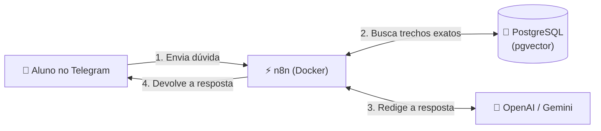
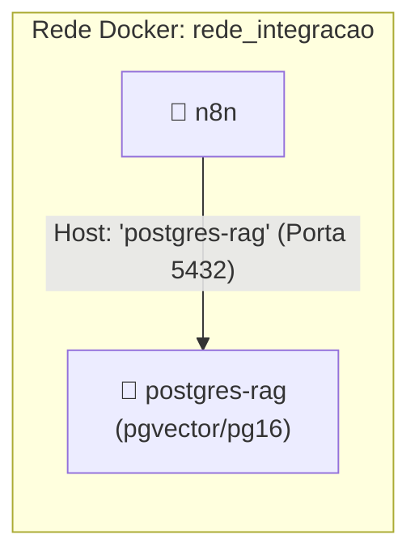
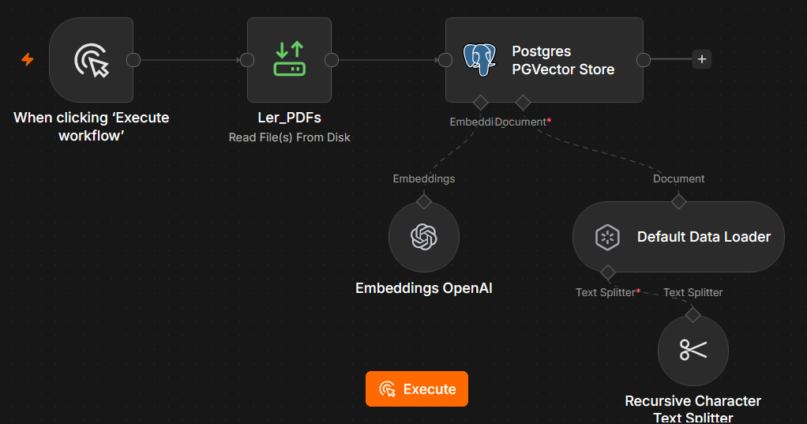
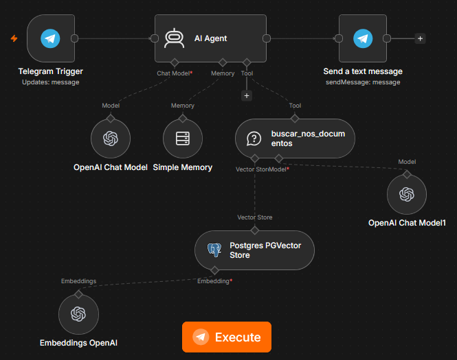

# Minicurso: Criando seu Próprio Agente de IA com n8n, Telegram e PostgreSQL

## Visão Geral do Treinamento
* **Instituição**: Instituto Federal do Sertão Paraibano — Campus Sousa.
* **Objetivo Geral**: Capacitar os participantes a construir um assistente inteligente no Telegram capaz de responder dúvidas técnicas consultando **estritamente** documentos e manuais em formato PDF através da arquitetura **RAG** (*Retrieval-Augmented Generation*).



---

## Módulo 1: O Conceito de RAG Descomplicado

### 1.1 Por que a IA Comum "Alucina"?
Modelos de inteligência artificial generativa (como o ChatGPT) foram treinados lendo dados públicos gerais da internet. Eles **não conhecem os manuais internos do seu campus, notas de aula dos professores ou regulamentos acadêmicos**. 

Se você fizer uma pergunta específica para o modelo puro, ele inventará uma resposta convincente, porém falsa (fenômeno conhecido como **alucinação**).

### 1.2 A Solução: A Analogia da "Prova com Consulta" (RAG)
O **RAG** (*Retrieval-Augmented Generation*) funciona exatamente como um aluno fazendo uma prova com consulta ao livro:
1. **A Pergunta**: O usuário envia uma dúvida pelo Telegram (*"O que é memória secundária?"*).
2. **A Consulta**: Em vez de adivinhar, o sistema faz uma busca no PostgreSQL e localiza a página e o parágrafo exatos que tratam daquele assunto.
3. **A Resposta**: O sistema entrega a pergunta e os trechos para a IA redigir uma explicação clara e amigável, proibindo-a de inventar dados fora do material.

---

## Módulo 2: Infraestrutura dos Containers no Docker

Para que os serviços conversem entre si no laboratório, criamos uma rede compartilhada chamada **`rede_integracao`**.

```bash
# Comando inicial para criar a rede compartilhada (executar apenas uma vez no terminal):
docker network create rede_integracao
```

### 2.1 Container do Banco de Dados: docker-compose-postgres.yml
Este arquivo sobe o banco de dados PostgreSQL já equipado com a extensão vetorial `pgvector`:

```yaml
services:
  postgres:
    image: pgvector/pgvector:pg16
    container_name: postgres-rag
    restart: unless-stopped

    environment:
      POSTGRES_DB: conhecimento
      POSTGRES_USER: rag_user
      POSTGRES_PASSWORD: {{senha_propria}}

    ports:
      - "5432:5432"
    
    networks:
      - rede_n8n

    volumes:
      - postgres_rag_data:/var/lib/postgresql/data

volumes:
  postgres_rag_data:
  
networks:
  rede_n8n:
    external: true
    name: rede_integracao
```

### 2.2 Container do Orquestrador de IA: docker-compose-n8n.yml
Este arquivo sobe o n8n conectado à mesma rede e com permissão para ler a pasta de PDFs do computador:

```yaml
services:
  n8n:
    image: docker.n8n.io/n8nio/n8n
    container_name: n8n
    restart: unless-stopped

    ports:
      - "5678:5678"
    
    # Servidores DNS para evitar travamentos de rede
    dns:
      - 1.1.1.1
      - 8.8.8.8

    environment:
      - TZ=America/Fortaleza
      - GENERIC_TIMEZONE=America/Fortaleza
      - N8N_COMMUNITY_PACKAGES_ENABLED=false
      - N8N_ENFORCE_SETTINGS_FILE_PERMISSIONS=true
      - N8N_RUNNERS_ENABLED=true
      - N8N_WEBHOOK_URL=https://references-notification-stated-words.trycloudflare.com
      
      # PERMISSÃO CRUCIAL: Libera a leitura da pasta interna de PDFs
      - N8N_RESTRICT_FILE_ACCESS_TO=/data

      - DB_TYPE=postgresdb
      - DB_POSTGRESDB_HOST=postgres-rag
      - DB_POSTGRESDB_PORT=5432
      - DB_POSTGRESDB_USER=rag_user
      - DB_POSTGRESDB_PASSWORD={{senha_propria}}
      - DB_POSTGRESDB_DATABASE=conhecimento

    volumes:
      - n8n_data:/home/node/.n8n
      # Mapeamento da pasta de PDFs do computador para dentro do container:
      - ./meus_pdfs:/data/documentos:ro
    networks:
      - rede_integracao

volumes:
  n8n_data:
  
networks:
  rede_integracao:
    external: true
    name: rede_integracao
```

---

## Módulo 3: Conexão entre os Containers e Script SQL Inicial



> **Atenção sobre o `localhost`**: De dentro do n8n, nunca use `localhost`. O Docker possui um DNS interno próprio onde cada container é localizado pelo seu próprio nome de serviço: **`postgres-rag`**.

### 3.1 Inicializando o Banco de Dados
Abra o terminal do computador e execute os comandos abaixo para habilitar a extensão e criar a tabela:

```bash
# 1. Habilita a extensão vetorial no banco conhecimento:
docker exec -it postgres-rag psql -U rag_user -d conhecimento -c "CREATE EXTENSION IF NOT EXISTS vector;"

# 2. Cria a tabela de documentos:
docker exec -it postgres-rag psql -U rag_user -d conhecimento -c "CREATE TABLE IF NOT EXISTS documentos_pdf (id SERIAL PRIMARY KEY, content TEXT, metadata JSONB, embedding VECTOR(1536));"
```

---

## Módulo 4: Fluxo 1 — Ingestão de PDFs no PostgreSQL

Neste fluxo, o n8n carrega o arquivo PDF da pasta, reparte o texto em fatias inteligentes (*chunks*), calcula as coordenadas matemáticas (vetores) e grava na tabela `documentos_pdf`.

### 4.1 Imagem do Workflow de Leitura de PDFs
Abaixo está o fluxo montado na tela do n8n:



### 4.2 Passo a Passo dos Nós
1. **When clicking 'Execute workflow'**: Disparo manual para processar novos PDFs.
2. **Ler_PDFs (Read File(s) From Disk)**:
   * **Operation**: `Read`
   * **File Path(s)**: `/data/documentos/conteudo_fundamentos_de_ti_hardware_e_software.pdf`
3. **Postgres PGVector Store**:
   * **Operation**: `Insert Documents`
   * **Table Name**: `documentos_pdf`
4. **Módulos Conectados na Base**:
   * **Embeddings OpenAI**: Modelo `text-embedding-3-small`.
   * **Default Data Loader**: Carrega o arquivo binário em formato legível de páginas.
   * **Recursive Character Text Splitter**: Corta o texto em pedaços de 1.000 caracteres com sobreposição de 200 caracteres, garantindo que frases importantes não sejam cortadas pela metade.

---

## Módulo 5: Fluxo 2 — O Assistente Inteligente no Telegram

Este fluxo fica ligado continuamente (*Active*). Ele ouve as dúvidas dos estudantes no Telegram, consulta o PostgreSQL e responde em tempo real.

### 5.1 Imagem do Workflow do Assistente
Abaixo está a estrutura completa do assistente com seu cérebro, memória e ferramentas:



### 5.2 Passo a Passo dos Nós
1. **Telegram Trigger (Updates: message)**:
   * Ouve as mensagens enviadas para o bot criado com o `@BotFather`.
2. **AI Agent (Tools Agent)**:
   * **Prompt (User Message)**: Ative a opção **Expression** e insira:
     ```text
     {{ $json.message.text }}
     ```
   * **System Message (Instrução Anti-Alucinação)**:
     ```markdown
     Você é um assistente especialista encarregado de tirar dúvidas sobre o conteúdo dos documentos PDF fornecidos.
     REGRAS:
     1. Para qualquer dúvida, consulte a ferramenta 'buscar_nos_documentos'.
     2. Responda única e exclusivamente com base no que constar nos documentos.
     3. Se a informação não estiver nos manuais, diga com educação:
        "Desculpe, essa informação não consta nos documentos que tenho disponíveis."
     4. Jamais deduza ou invente respostas.
     ```
3. **Módulos de Suporte Conectados ao AI Agent**:
   * **OpenAI Chat Model**: Modelo `gpt-4o-mini`.
   * **Simple Memory**: Lembra o contexto da conversa.
     * No campo **Key**, selecione **Define below** e insira:
       ```text
       {{ $('Telegram Trigger').item.json.message.chat.id }}
       ```
   * **buscar_nos_documentos (Vector Store Tool)**: Ferramenta que pesquisa no banco vetorial. Conectada ao **Postgres PGVector Store** e ao **OpenAI Chat Model1**.
4. **Send a text message (Telegram)**:
   * Devolve a resposta final para o chat do aluno:
     * **Chat ID**: `{{ $('Telegram Trigger').item.json.message.chat.id }}`
     * **Text**: `{{ $json.output }}`

---

## Módulo 6: Guia de Resolução de Problemas (Troubleshooting)

| Erro Encontrado | Causa Técnica | Solução Rápida |
| :--- | :--- | :--- |
| **`No file(s) found`** | Foi digitado o caminho do Windows (`C:\...`) em vez do caminho interno Linux. | Use `/data/documentos/nome_do_arquivo.pdf`. |
| **`Access to the file is not allowed`** | Trava de segurança padrão do n8n bloqueando leitura fora da pasta inicial. | Adicione `- N8N_RESTRICT_FILE_ACCESS_TO=/data` no arquivo do n8n e reinicie. |
| **`429 You have no credits remaining`** | Saldo zerado na conta de desenvolvedor da OpenAI. | Adicione $5 na OpenAI ou alterne gratuitamente para a API do Google Gemini. |
| **`Parameter "Prompt" is required`** | O nó AI Agent está sem a mensagem de entrada. | Defina como Expression com `{{ $json.message.text }}`. |
| **`Key parameter is empty (Memory)`** | A memória não recebeu o número identificador do chat. | Mude para **Define below** e coloque `{{ $('Telegram Trigger').item.json.message.chat.id }}`. |
| **`ECONNREFUSED` ao conectar no banco** | Foi configurado `localhost` no host da credencial. | Altere o host para o nome do container: `postgres-rag`. |


